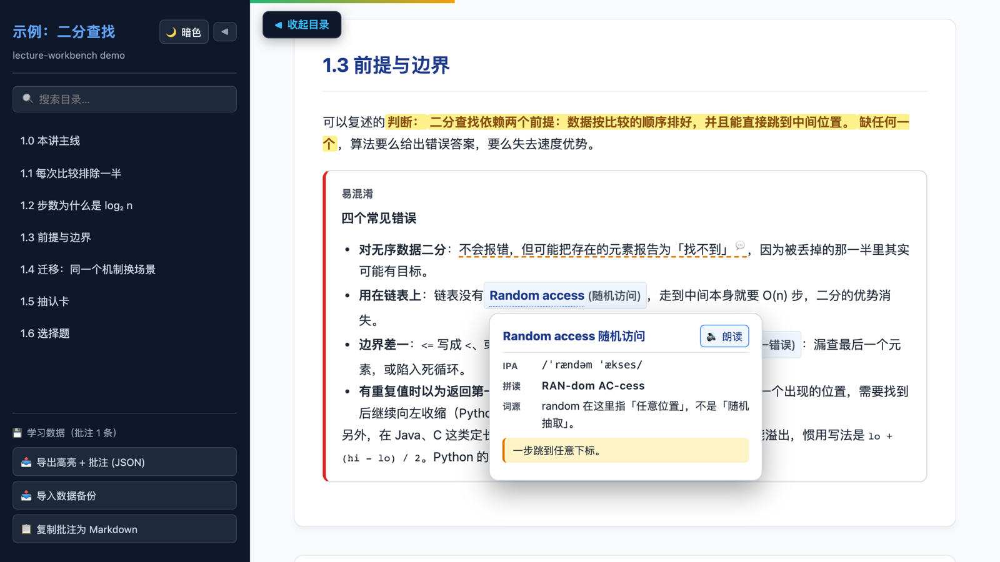

# lecture-workbench

[](https://github.com/JoshuaViolet/lecture-workbench/actions/workflows/ci.yml)
[](LICENSE)

Turn lecture notes into a **single, self-contained HTML study guide** that works offline. Double-click the file and you get highlights, margin notes, term cards, flashcards and practice questions: no server, no CDN, no install. Images are embedded too, so the one file is all a student needs, whether it was emailed, downloaded or copied to a phone.

**[Live demo](https://joshuaviolet.github.io/lecture-workbench/)** · [架构说明 / Architecture](docs/architecture.md) · [中文说明](README.zh-CN.md)



> Status: **v0.2, early**. I built this for my own university courses and extracted it into a reusable tool. The page interface comes in Simplified Chinese (default) or English. Open problems are listed in [KNOWN_ISSUES.md](KNOWN_ISSUES.md).

## Features

- **Highlights and margin notes** that survive reloads, even when the selection crosses bold text or other inline markup. Stored per guide in `localStorage`; export as JSON and import it on another device, choosing to merge it with what is already there or to replace that, or copy as Markdown in reading order. Two open tabs don't overwrite each other, and a note being typed is kept if you click away.
- **Term cards** on hover: IPA, stressed syllables, etymology, a memory hook, and pronunciation through the Web Speech API.
- **Flashcards** and **multiple-choice questions** with explanations. Options are shuffled on every render so the position of the answer can't be learned instead of the content. A question can carry a code block, shown exactly as written. The page remembers which questions you got wrong last time and can narrow practice to those.
- **Figures** from local image files, embedded at build time; click one to see it full size.
- **Teaching components** for structuring a lesson: chapter spine, evidence / limitation / misconception / transfer blocks, study cards.
- **Print mode** that forces a light theme and appends a self-test sheet with the answer key.
- Dark mode (follows the system until you choose), a contents list that marks the section you're reading, layouts for phones (wide tables scroll sideways), reading progress, keyboard support, `prefers-reduced-motion`.

## Quick start

Requires Python 3.9+. Node.js is recommended: the validator uses it to syntax-check the page and audit term cards, and skips those two checks (saying so) without it.

```bash
git clone https://github.com/JoshuaViolet/lecture-workbench.git
cd lecture-workbench
python3 framework/cli.py build --all --validate
open subjects/demo-binary-search/Binary_Search_Demo.html
```

## Commands

`framework/cli.py` has three subcommands:

```bash
python3 framework/cli.py new subjects/my-lecture --title "My Lecture"   # scaffold a subject (--lang en for English)
python3 framework/cli.py build subjects/my-lecture --validate           # build, then check the page
python3 framework/cli.py validate subjects/my-lecture --strict          # check an already built page
```

| Command | Does |
|---|---|
| `new <dir> [--title T] [--doc-id ID] [--output NAME.html] [--lang zh\|en]` | Creates `config.json`, `content.html` and `data.json` with one example of each part (section, term card, flashcard, question), in the interface language given (Chinese by default). The result builds and passes `--strict` as is. Ids and the output name come from the folder name unless given; `new` refuses a folder that is not empty and a `doc_id` another subject under the same parent or `subjects/` already uses. |
| `build (<dir>... \| --all) [--validate] [--strict]` | Builds each subject into its single-file guide, reports its size, and keeps going after a failure. `--all` builds every folder with a `config.json` under `subjects/`. |
| `validate (<dir> \| <guide.html>) [--strict]` | Runs the checks below on a built guide. Given a subject folder, it checks the file named by `config.output`. |

Every command exits non-zero on failure, so they work in CI. `framework/build_guide.py` and `framework/validate_guide.py` still run on their own with the same flags.

## Writing a subject

A subject is a folder under `subjects/` (`cli.py new` creates one):

```
subjects/my-lecture/
  config.json      identity, titles, header and table-of-contents HTML, output file name
  content.html     the lesson body: <section>s with your text, figures and components
  data.json        flashcards, mcqData, termLexicon
  assets/          images referenced from content.html (optional; embedded in the built page)
```

`config.json`:

```json
{
  "doc_id": "my_lecture",
  "app_id": "my-lecture-guide",
  "title": "My Lecture",
  "output": "My_Lecture.html",
  "lang": "en",
  "header_html": "<header class=\"doc-header\"><h1>My Lecture</h1></header>",
  "nav_html": "<li><a href=\"#intro\">Introduction</a></li>"
}
```

`doc_id` namespaces everything the guide stores, so it must be unique across your guides and must not change after you start using a guide.

`embed_images` (default `true`) puts every local image the lesson references inside the built page as a `data:` URI, so the guide stays one file; a missing image fails the build. Set it to `false` only if you will always ship the guide together with its `assets/` folder.

`lang` sets the language of the page's own interface (toolbar, sidebar, messages, print sheet): `"zh"` for Simplified Chinese (the default) or `"en"` for English. Your lesson content is written in whatever language you like. The strings live in [`framework/ui_strings.json`](framework/ui_strings.json); to add a language, add a table with the same keys.

`data.json` (checked at build time; errors point at the exact item and field):

```json
{
  "flashcards":  [{ "front": "…", "back": "…" }],
  "mcqData":     [{ "q": "…", "opts": ["…", "…", "…", "…"], "ans": 2, "exp": "…" }],
  "termLexicon": [{ "keys": ["binary search"], "term": "Binary search 二分查找",
                    "ipa": "/ˈbaɪnəri sɜːtʃ/", "chunks": "BI-na-ry SEARCH",
                    "parts": "…", "hook": "…" }]
}
```

`ans` is the 0-based index of the correct option in `opts`. Add `"shuffle": false` to a question whose options must stay in order. A question about code puts the code in an optional `"code"` field, shown under the stem in a monospace block with its line breaks and indentation kept; an option that contains a line break (`\n`) is shown as code too. A term in `content.html` gets a hover card when it is written as

```html
<span class="term"><span class="en">Binary search</span> <span class="zh">(二分查找)</span></span>
```

or as `<strong>…</strong>` text that matches one of the `keys`. A figure is an image in `assets/`:

```html
<figure class="slide-fig">
  
  <figcaption>Lecture 3, S12: what to look at.</figcaption>
</figure>
```

The build embeds it; clicking it (or Enter) opens it full size. Use JPEG or WebP for slides and photos: the build warns when a guide passes 25 MB, which phones open slowly. Copy-paste snippets for the teaching components are in [examples/](examples/).

How to write the lesson and the questions (block order, question types, what to leave out) is in [AGENTS.md](AGENTS.md), with supplements for [psychology](docs/writing/psychology.md), [economics](docs/writing/economics.md) and [data science / programming](docs/writing/data-science.md). It is written so that you can hand it to an AI assistant that drafts a subject for you.

Coming from the older `data.js` format: `python3 framework/migrate_datajs.py subjects/<name>`.

## Validation

`cli.py build --validate` (or `cli.py validate`) checks the generated page:

| Check | Catches |
|---|---|
| structure | broken `#anchors`, `getElementById` targets that don't exist, undefined inline handlers, unbalanced tags, unfilled placeholders, script syntax errors |
| offline | local files the page points to that don't exist. Warnings, never failures: anything it would load from the network (a CDN script, a web font, a hotlinked image, an iframe), which won't show offline, and files the guide needs beside it |
| content | raw LaTeX in prose or data (there is no math renderer; code and amounts such as "$5 to $10" are not taken for LaTeX), English terms with no term card |
| teaching-quality lint | the correct option being the only longest one in more than 40% of questions, question-type tags in stems (`Mechanism: …`), explanations that name options by letter although options are shuffled, answers clustered on one letter in fixed-order questions, duplicate questions |

Lint findings are warnings; `--strict` turns them into failures. Without Node.js, the syntax check and the term-card audit are skipped and the summary says so.

## Development

```bash
python3 -m venv .venv && .venv/bin/pip install -r requirements-dev.txt
.venv/bin/python -m playwright install chromium   # or set PW_CHANNEL=chrome to use an installed Chrome
.venv/bin/pytest
```

The suite has unit tests for the builder and validator, and Playwright tests that open the built demo from `file://` and drive it like a student: select text, click the toolbar, reload, work in two tabs, export a backup and merge it into or replace another browser's annotations, answer questions and come back, open the guide copied on its own.

## License

[MIT](LICENSE)

## Acknowledgments

Developed with AI assistance (Claude).
